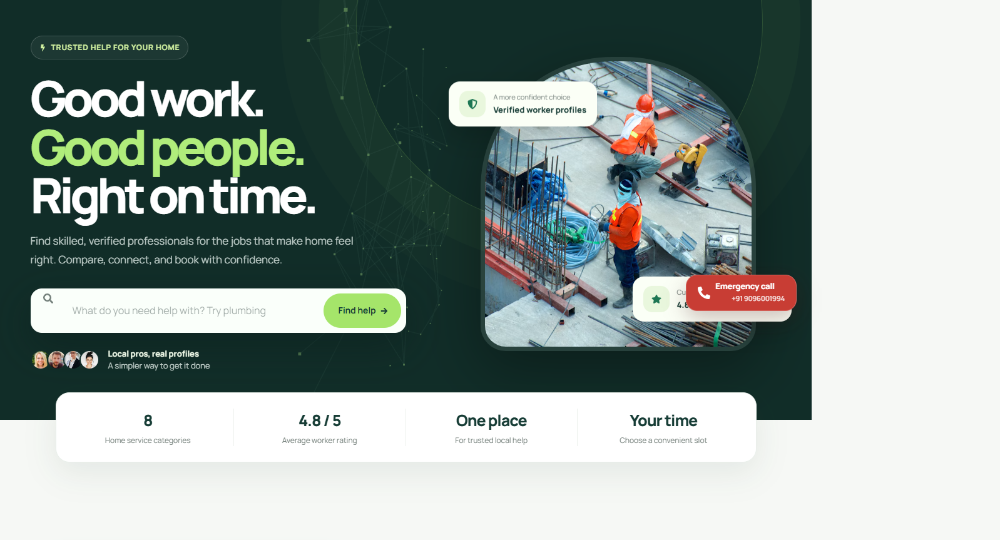

# SkillConnect

SkillConnect is a full-stack marketplace for discovering local home-service professionals, comparing profiles, and managing service bookings.

<p align="center">
  
</p>

<p align="center">
  
</p>

## What it includes

- Search service categories and browse worker profiles, ratings, and availability.
- Customer accounts, password reset flow, and booking history.
- Worker dashboards for assigned booking requests and status updates.
- Admin console for marketplace metrics, orders, accounts, and worker assignments.
- Emergency support call action, customer reviews, and newsletter signup.

## Technology

- **Frontend:** React, Vite, Material UI, Framer Motion, Three.js
- **API:** Node.js, Express, Mongoose, JSON Web Tokens
- **Database:** MongoDB

## Project layout

```text
src/                  React application
public/               Static frontend assets
server/src/           Express API, models, routes, and middleware
docs/screenshots/     README screenshots
```

## Run locally

Requirements: Node.js 20+ and a MongoDB instance (local MongoDB or MongoDB Atlas).

Install both frontend and API dependencies from the repository root:

```bash
npm install
npm --prefix server install
```

Create `server/.env` from the example and configure `MONGODB_URI` and a long, random `JWT_SECRET`.

PowerShell:

```powershell
Copy-Item server\.env.example server\.env
```

macOS/Linux:

```bash
cp server/.env.example server/.env
```

Start the API and frontend in separate terminals:

```bash
npm run dev:api
npm run dev
```

The frontend is available at `http://localhost:5173`; the API listens on `http://localhost:5000`. Vite proxies frontend `/api` requests to the API. Check the API connection at `http://localhost:5000/api/health`.

To load the service catalog and sample worker/review records into MongoDB:

```bash
npm run seed
```

## Administrator access

Register a normal account, then promote it from the repository root:

```bash
npm run promote-admin -- admin@example.com
```

Sign out and back in to refresh the session. The administrator console is available at `/admin`; admin APIs require an administrator account.

Password reset tokens are returned only in development until an email provider is configured. See [server/README.md](server/README.md) for API routes and additional backend notes.

## Quality checks

```bash
npm run lint
npm run build
```

## Configuration and security

Keep real credentials in `server/.env`; environment files are ignored by Git. Never commit MongoDB connection strings, JWT secrets, or production credentials.